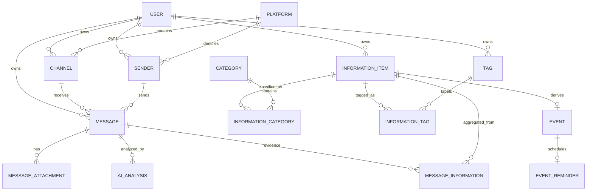

# ER 图与真实表结构对应清单

> 本文件是 Phase 6 的 ER/模型图校对基线。权威实现为 Alembic revision `8f3c0d29a2b7` 和 `backend/app/models/entities.py`；字段含义见 `docs/DATA_DICTIONARY.md`。

## 1. 16 张核心表字段清单

| 表 | 字段（按模型定义） |
|---|---|
| `user` | `id`, `username`, `display_name`, `password_hash`, `status`, `session_version`, `last_login_at`, `created_at`, `updated_at` |
| `system_setting` | `setting_key`, `value_text`, `value_type`, `is_sensitive`, `description`, `updated_at` |
| `platform` | `id`, `name`, `type`, `status`, `created_at` |
| `channel` | `id`, `user_id`, `platform_id`, `external_id`, `name`, `channel_type`, `created_at` |
| `sender` | `id`, `user_id`, `platform_id`, `external_id`, `display_name`, `source_type`, `credibility`, `created_at` |
| `message` | `id`, `user_id`, `channel_id`, `sender_id`, `external_id`, `content`, `sent_at`, `ingested_at`, `process_status`, `processing_started_at` |
| `message_attachment` | `id`, `message_id`, `external_id`, `file_type`, `file_name`, `file_url`, `storage_key`, `file_size`, `sha256`, `download_status`, `download_attempts`, `downloaded_at`, `last_error`, `extracted_text`, `created_at`, `updated_at` |
| `ai_analysis` | `id`, `message_id`, `model_name`, `status`, `useful`, `error_code`, `error_message`, `latency_ms`, `raw_result`, `raw_response_text`, `analyzed_at`, `created_at` |
| `information_item` | `id`, `user_id`, `title`, `summary`, `source_type`, `importance`, `confidence`, `status`, `version`, `created_at`, `updated_at` |
| `message_information` | `user_id`, `message_id`, `information_id`, `relation_type`, `created_at` |
| `category` | `id`, `name`, `description`, `status`, `created_at` |
| `information_category` | `information_id`, `category_id` |
| `tag` | `id`, `user_id`, `name`, `created_at` |
| `information_tag` | `user_id`, `information_id`, `tag_id` |
| `event` | `id`, `information_id`, `start_at`, `deadline`, `event_status`, `created_at`, `updated_at` |
| `event_reminder` | `id`, `event_id`, `remind_at`, `reminder_status`, `is_custom_time`, `triggered_at`, `read_at`, `created_at`, `updated_at` |

## 2. 概念 ER 图（Mermaid 源）

`SYSTEM_SETTING` 是独立的受控系统设置实体，不连接用户私有业务表；管理员凭据与注册开关存放于登记键中，但管理员不是 `USER` 的角色行。

## 3. 物理外键与基数

| 子表字段 | 父表字段 | 删除策略 | 基数/业务含义 |
|---|---|---|---|
| `channel.user_id` | `user.id` | RESTRICT | User 1:N Channel |
| `channel.platform_id` | `platform.id` | RESTRICT | Platform 1:N Channel |
| `sender.user_id` | `user.id` | RESTRICT | User 1:N Sender |
| `sender.platform_id` | `platform.id` | RESTRICT | Platform 1:N Sender |
| `message.user_id` | `user.id` | RESTRICT | User 1:N Message |
| `message(user_id,channel_id)` | `channel(user_id,id)` | RESTRICT | Message 与 Channel 必须同用户 |
| `message(user_id,sender_id)` | `sender(user_id,id)` | RESTRICT | Message 与 Sender 必须同用户 |
| `message_attachment.message_id` | `message.id` | CASCADE | Message 1:N Attachment |
| `ai_analysis.message_id` | `message.id` | CASCADE | Message 1:N AIAnalysis |
| `information_item.user_id` | `user.id` | RESTRICT | User 1:N InformationItem |
| `message_information(user_id,message_id)` | `message(user_id,id)` | CASCADE | M:N 证据侧且同用户 |
| `message_information(user_id,information_id)` | `information_item(user_id,id)` | CASCADE | M:N 信息侧且同用户 |
| `information_category.information_id` | `information_item.id` | CASCADE | InformationItem M:N Category |
| `information_category.category_id` | `category.id` | RESTRICT | 全局分类保留历史引用 |
| `tag.user_id` | `user.id` | RESTRICT | User 1:N Tag |
| `information_tag(user_id,information_id)` | `information_item(user_id,id)` | CASCADE | M:N 信息侧且同用户 |
| `information_tag(user_id,tag_id)` | `tag(user_id,id)` | RESTRICT | M:N 标签侧且同用户 |
| `event.information_id` | `information_item.id` | CASCADE + UNIQUE | InformationItem 1:0..1 Event |
| `event_reminder.event_id` | `event.id` | CASCADE + UNIQUE | Event 1:0..1 Reminder |

## 4. 图表校对规则

1. 总表数必须写 **16**，不能使用旧版 13/15 表口径。
2. `User` 与 `Sender` 不得混淆：前者是系统账号，后者是外部消息发送者。
3. `SystemSetting` 独立存在；管理员不是 `User.role=ADMIN`。
4. `Message`、`InformationItem`、`Tag` 必须明确用户归属。
5. `MessageInformation` 和 `InformationTag` 必须画出 `user_id` 复合外键，不能只画单列逻辑关联。
6. `Message` ↔ `InformationItem` 是 M:N，并带 `relation_type`。
7. `InformationItem` ↔ `Event`、`Event` ↔ `EventReminder` 都是 1:0..1，并由 UNIQUE 约束保证。
8. 附件要表现为 `MessageAttachment` 元数据 + 受控本地文件，不把二进制文件塞入数据库。
9. Category 全局共享，Tag 用户私有；二者都通过关联表建模。
10. 图中时间字段应标注 UTC 存储；提醒默认由 Deadline 减 24 小时派生。

## 5. 可追溯来源

- ORM：`backend/app/models/entities.py`
- 初始迁移：`backend/alembic/versions/4ae437bb1586_create_initial_schema.py`
- 高级对象迁移：`backend/alembic/versions/8f3c0d29a2b7_add_statistics_objects.py`
- 详细设计：`docs/DATABASE.md`
- 字段解释：`docs/DATA_DICTIONARY.md`
- 展示绘图说明：`pre/07_数据库ER图绘制说明.md`、`pre/08_数据库模型图绘制说明.md`、`pre/13_多用户版分模块用例图与ER图说明.md`
